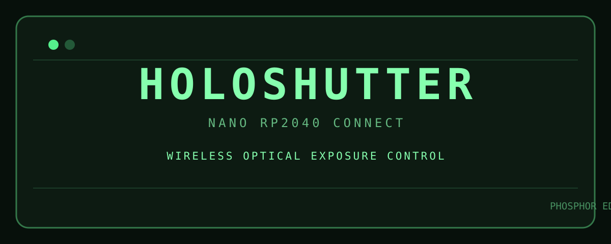

# HOLOSHUTTER

**An open-source, Wi-Fi-controlled exposure shutter for DIY holography.**



HOLOSHUTTER is a small optical exposure controller built around an **Arduino Nano RP2040 Connect** and an **SG90 micro servo**. It hosts its own local Wi-Fi network and serves a phone-friendly, retro green-phosphor web interface. No internet connection or separate phone app is required.

> **Project status:** Working prototype, tested by the project creator. The original working Arduino sketch is being preserved before publication; do not substitute an untested rewrite.

## Features

- Local Wi-Fi access point and browser-based control
- Manual **OPEN SHUTTER** / **CLOSE SHUTTER** commands
- Custom exposure duration in minutes and seconds
- **EXECUTE EXPOSURE** and **CANCEL EXPOSURE**
- Live countdown and shutter status
- Automatic shutter closure when exposure finishes
- Retro-futuristic green phosphor user interface
- HTML/CSS/JavaScript embedded in the Arduino sketch

## Hardware

| Item | Purpose |
| --- | --- |
| Arduino Nano RP2040 Connect | Wi-Fi access point, HTTP server, timing and servo control |
| SG90 micro servo | Moves the shutter |
| Regulated 5 V supply | Powers the servo independently of the microcontroller |
| Shutter blade / mount | Blocks and passes the laser beam |
| Jumper wires and common ground | Electrical connections |
| USB cable | Programming and board power |

See the [bill of materials](hardware/components.md) and [wiring guide](hardware/wiring.md).

## Wiring at a glance

| SG90 lead | Connect to |
| --- | --- |
| Signal (usually orange/yellow) | Nano **D9** |
| Power (usually red) | External regulated **5 V** |
| Ground (usually brown/black) | External supply **GND** and Nano **GND** (common ground) |

**Never power the SG90 from a 3.3 V GPIO pin.** Check your actual servo lead colors and supply polarity before powering up.

## Installation

1. Install the **Arduino Mbed OS Nano Boards** board package in Arduino IDE, or use Arduino Cloud.
2. Select **Arduino Nano RP2040 Connect**.
3. Install the **WiFiNINA** and **Servo** libraries.
4. Open and upload the verified working sketch once it is published in `firmware/`.
5. Connect your phone to the board's access point.
6. Open the address printed in Serial Monitor (typically **http://192.168.4.1**).
7. Test manual OPEN/CLOSE without the laser before running a timed exposure.

For detailed setup and troubleshooting, see [setup-guide.md](documentation/setup-guide.md).

## Current prototype configuration

| Setting | Value |
| --- | --- |
| Servo signal | D9 |
| Closed angle | 0° |
| Open angle | 68° |
| Opening settle delay | 700 ms |
| Maximum exposure | 210 seconds (3:30) |
| Wi-Fi SSID | `HoloShutter-RP2040` |
| Default access point | `192.168.4.1` |

The servo angles depend on the physical shutter mechanism. **Verify clearances before changing angles.**

## Demo

A working prototype demo was recorded. The original video will be added to this repository when its final upload is available. The [media folder](media/) contains the project banner.

## Safety and limitations

- Use a proper laser beam stop and appropriate wavelength-rated laser eyewear. Do not look into the laser beam.
- A hobby servo shutter is **not a certified laser safety shutter** or an interlock.
- Do not rely on Wi-Fi connectivity, a browser countdown, or servo motion as a laser safety system.
- Timing begins after the configured servo settling delay; actual optical exposure also depends on the mechanical shutter's opening and closing travel.
- The controller does not measure optical power or confirm shutter position with a sensor.
- Protect the board from brownouts by using an adequate servo supply and common ground.
- The Wi-Fi network is local. Change the default password before using the system around others.

## Project structure

```text
HoloShutter/
├── README.md
├── LICENSE
├── firmware/             # Verified Arduino sketch (pending original upload)
├── hardware/
│   ├── components.md
│   └── wiring.md
├── documentation/
│   └── setup-guide.md
└── media/
    └── holoshutter-banner.svg
```

## Acknowledgments

Created by **MENTLONE** as a practical tool for experimental holography. Thanks to the Arduino community and the maintainers of the WiFiNINA and Servo libraries.

## License

Distributed under the [MIT License](LICENSE). Hardware designs, photographs, and video may need separate licensing if added later.
